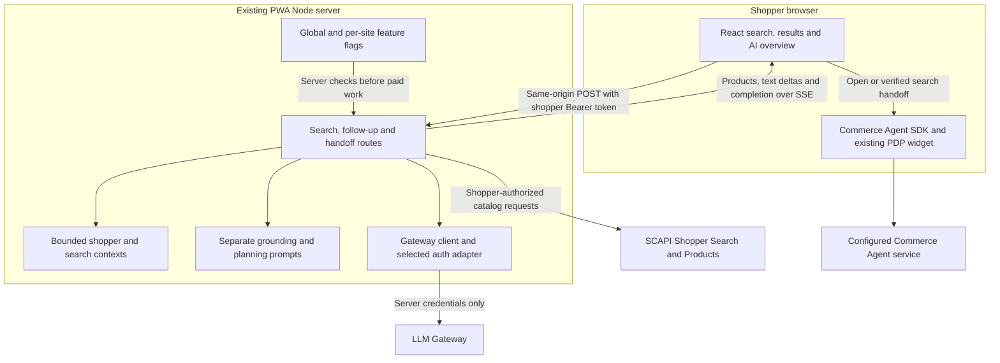
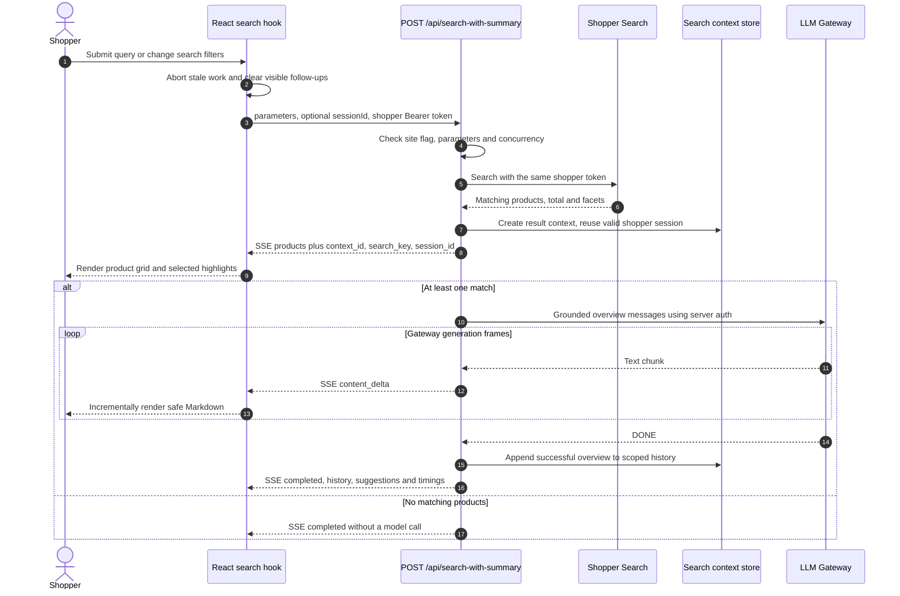
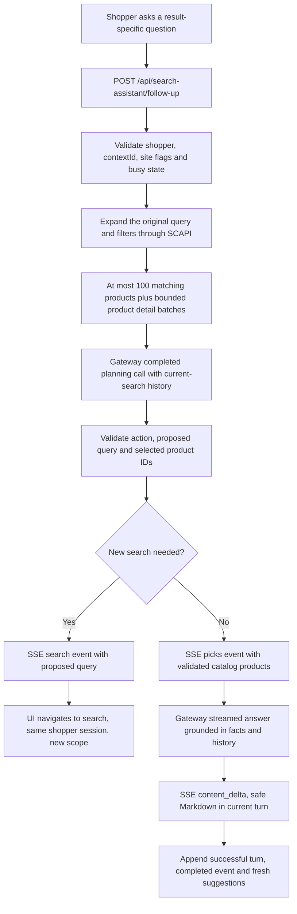
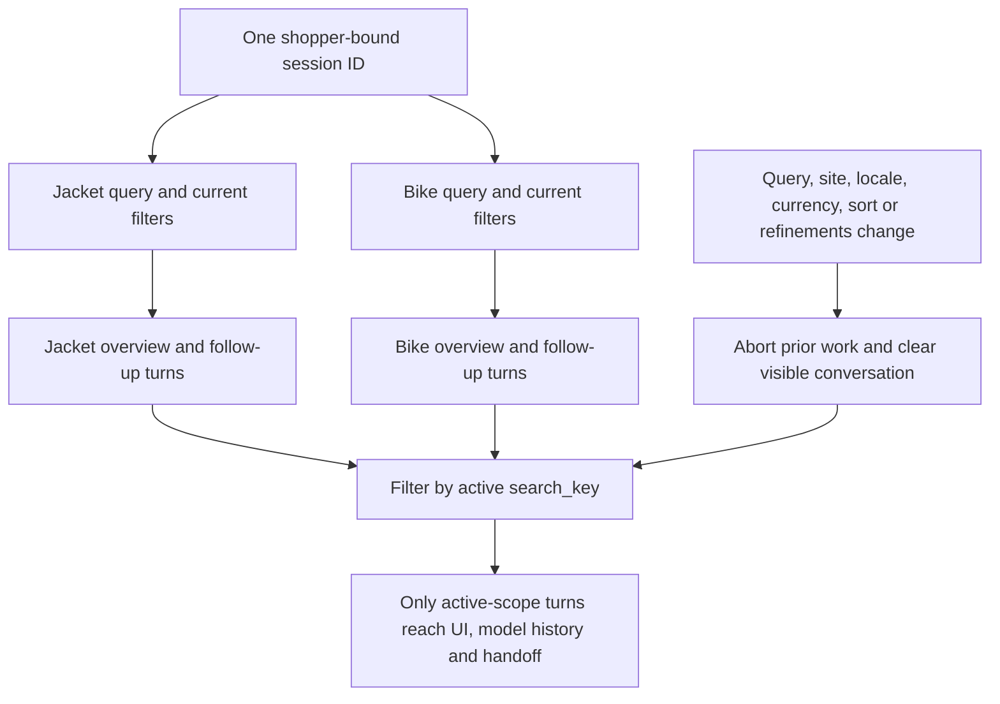
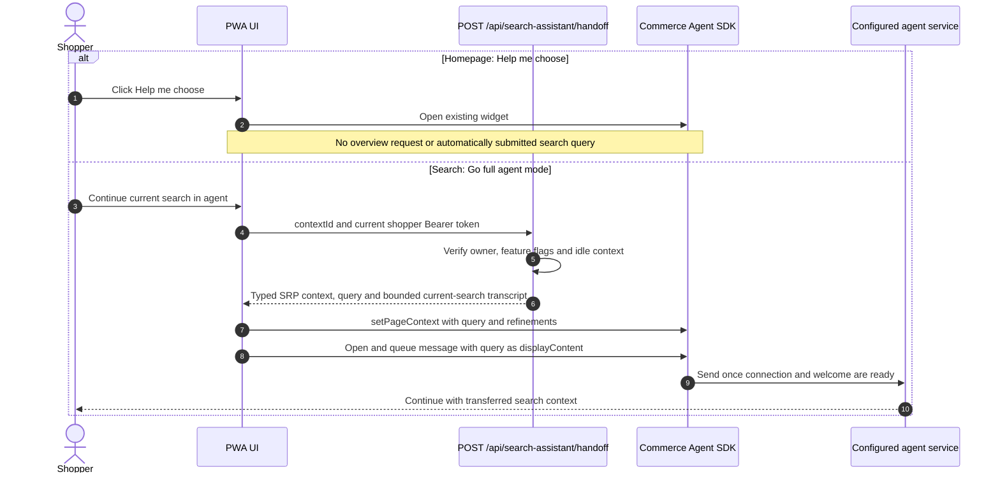
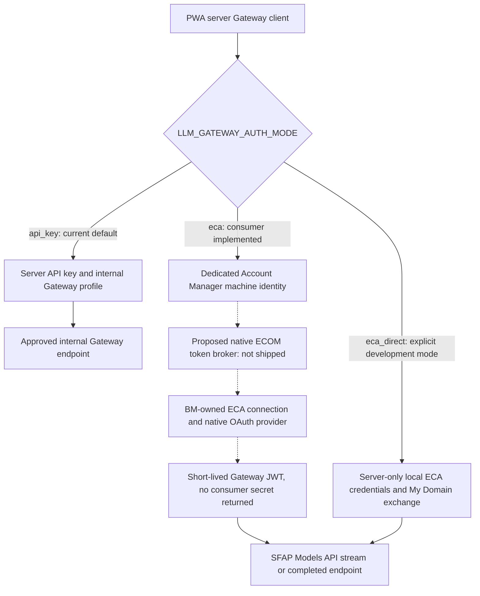

# PWA AI search: architecture and request flows

This guide describes the configurable AI-search implementation in this draft.
Start with the component diagram, then use the sequences to explain individual
requests. Configuration and rollout instructions are in
[README-SEARCH-SUMMARY.md](README-SEARCH-SUMMARY.md).

## PWA and SFRA at a glance

| Concern | PWA | SFRA cartridge |
| --- | --- | --- |
| Application runtime | Existing PWA Node/SSR server, locally or on MRT | Existing B2C Commerce cartridge runtime |
| Product search | SCAPI Shopper Search, authorized with the shopper's SLAS token | Native SFRA search and `ProductSearchModel` |
| Overview delivery | Real SSE over a browser `fetch` POST | Completed JSON, then progressive word reveal |
| Follow-up | Bounded catalog expansion, completed planning call, then streamed answer or new search | One completed routing/answer call, then answer or new-search link |
| Conversation | Shopper-token-bound session; history filtered by search scope | Native shopper session; signed history envelope per search |
| Homepage action | “Help me choose ↗” opens the existing widget | Same label, pill treatment and open-only behavior |
| Search handoff | Server-verified context and queued query | Server-verified context and queued query |
| Additional streaming service | None; the PWA server owns SSE | None; the cartridge owns the completed call |

There is no new GCP service or external ML router in either current storefront
flow. PWA's follow-up planner is an LLM request in the existing PWA server.
The companion [SFRA guide](https://github.com/SalesforceCommerceCloud/plugin_commerce_client/blob/codex/configurable-ai-search/docs/AI-SEARCH-ARCHITECTURE.md)
describes its different transport and native session model.

## 1. Components and trust boundaries

The SLAS shopper token authorizes catalog access and binds the search session.
Gateway API keys/OAuth tokens are a separate server identity. Neither Gateway
credentials nor BM ECA secrets enter browser configuration. The Commerce Agent
has its own connection and conversation; it does not reuse a Gateway session.

The master flag is off by default. Global `app.searchSummary` settings merge with
`app.sites[].searchSummary`. Disabled sites are rejected before catalog/model
work; all-disabled startup registers no assistant routes. Category browsing
continues through the normal SCAPI hook.

## 2. New keyword search: products first, then real streaming

SSE uses a POST `fetch` response reader rather than browser `EventSource`.
After SCAPI succeeds, the route sends `: ok`, then heartbeat comments every 15 s.
It honors writable backpressure, disables buffering/transforms and cancels on
disconnect or the 90 s request deadline. The Gateway parser accepts SSE line
endings and split UTF-8, resets event names, skips empty generation frames and
Trust Layer scoring frames, and requires `[DONE]` for a successful answer.

Overview grounding describes selected highlights rather than claiming that the
few highlighted products are the entire result set. The grid remains available
if the model fails after the `products` event.

## 3. Follow-up: answer from current facts or start another search

The completed planner and streamed answer are separate model calls. A `search`
decision emits no answer generation; the hook navigates through the normal
keyword-search path. The planner cannot supply arbitrary products: selected IDs
must belong to the server's current catalog context. Material/care facts absent
from that context remain unknown. Coverage metadata prevents presenting a bounded
sample as an exhaustive check of every result.

## 4. One shopper session, separate search conversations

The browser retains only the opaque session ID in `sessionStorage`; active
context/token references and handoff reservations stay in memory. The server
binds sessions to a SHA-256 fingerprint of the SCAPI-validated shopper Bearer
token. Expiry is at most ten minutes and is shortened for an earlier JWT expiry.
Expired/changed authentication cannot retrieve another shopper's context.

The server stores at most eight recent turns per session; history is filtered by
the active search key before use. Pagination and response expansions do not
change that key. The initial request creates a result-context ID, while a valid
`sessionId` can continue across new searches. A stale session response makes the
client discard the ID and retry without it. This is application-managed message
history, not an LLM-owned remote conversation session.

The current context store and concurrency limiter are process-local (60 session
and result records, three simultaneous generations, one active answer per
session). Shared TTL storage and distributed quotas remain rollout dependencies
for multiple MRT processes/instances.

## 5. Homepage opening and full-agent search handoff

Handoff itself makes no Gateway call. A context/revision reservation prevents a
second automatically sent query on reopening. An accepted or uncertain send is
not retried automatically. Homepage opening and result-context handoff are
intentionally distinct entry points. PDP questions continue using the existing
embedded-agent configuration and product context independently.

## 6. Gateway authentication: current and gated paths

Dashed edges are companion platform work required before BM-backed `eca` can
run. BM remains the owner of the ECA client ID/secret/My Domain; PWA stores only
its restricted AM machine credentials and the fixed broker URL. The broker sees
no shopper token, prompt or product data and does not proxy SSE. The PWA server
continues streaming directly from Gateway to the browser.

ECA adapters cache short-lived JWTs, share refreshes and retry a Gateway 401 once
before any answer output; they never restart a partial answer or fall back to an
API key. Direct ECA has not been live-enabled in this draft. See the precise
[BM broker contract and rollout gate](BM-ECA-TOKEN-BROKER.md).

## 7. Failure behavior and code map

| Trigger | Result |
| --- | --- |
| Feature off, invalid site/scope or unauthorized shopper | Reject before paid model work |
| SCAPI failure before `products` | Search error; no model call |
| Gateway failure after products | Generic AI error; keep product grid |
| Search change or disconnect | Abort work and ignore stale deltas/completions |
| Missing/expired context | Ask for a fresh search; no cross-shopper history |
| Raw model HTML, unsafe link or remote image | Restricted Markdown rendering; native product cards own images |

Paths below are relative to `packages/template-retail-react-app/`.

| Responsibility | Source |
| --- | --- |
| Global/per-site feature flags | [app/utils/search-summary-config.js](../app/utils/search-summary-config.js) |
| Homepage and compact search | [app/components/ai-search/index.jsx](../app/components/ai-search/index.jsx) |
| Fetch/SSE reader, scoped visible turns and navigation | [app/hooks/use-search-with-summary.js](../app/hooks/use-search-with-summary.js) |
| Client session and handoff reservation | [app/contexts/search-assistant-session.jsx](../app/contexts/search-assistant-session.jsx), [app/utils/search-agent-handoff.js](../app/utils/search-agent-handoff.js) |
| Product search and initial overview endpoint | [app/server/search-summary.js](../app/server/search-summary.js) |
| Follow-up planning, streaming and handoff endpoints | [app/server/search-assistant.js](../app/server/search-assistant.js) |
| Context/history, catalog expansion and prompts | [app/server/search-assistant/](../app/server/search-assistant/) |
| Gateway transport, parsing and auth modes | [app/server/llm-gateway.js](../app/server/llm-gateway.js), [app/server/llm-gateway/auth/](../app/server/llm-gateway/auth/) |

No keys, tokens, prompts, transcript bodies or generated content belong in logs.
The diagrams describe draft code, not a claim of live native BM/ECA integration
or scaled production validation.
